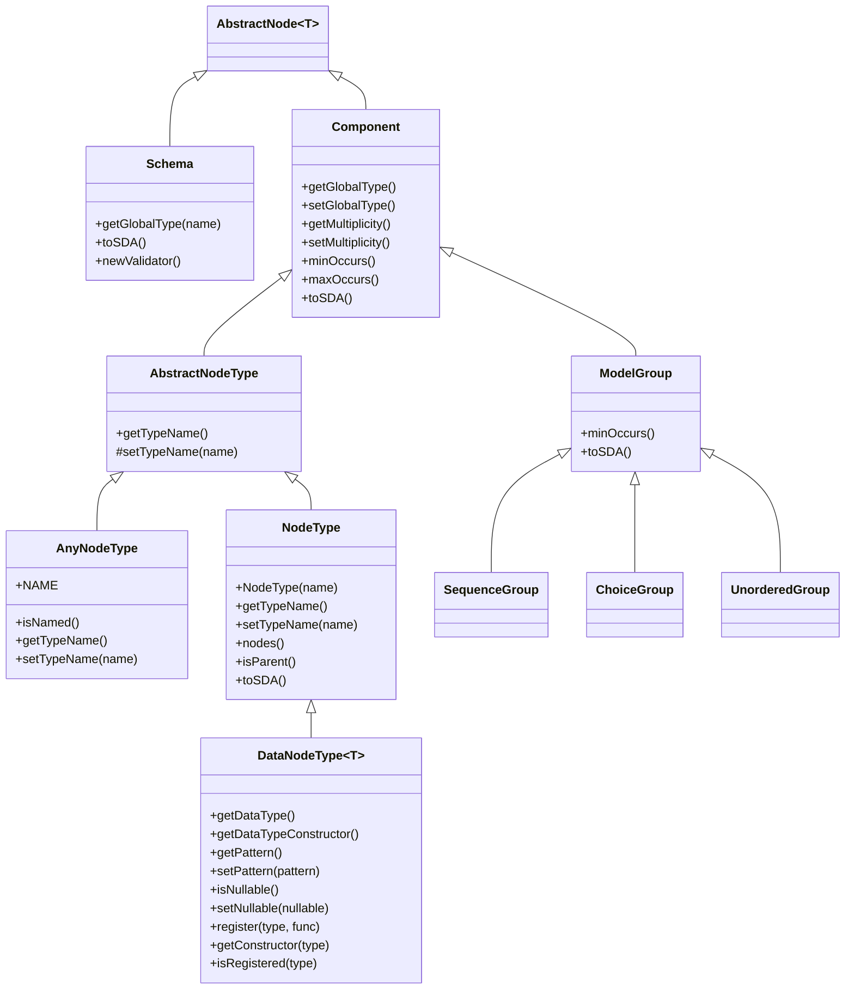

# SDS Specification

- [Grammar](#grammar)
- [In words](#in-words)
- [SDS class hierarchy](#sds-class-hierarchy)
	- [Diagram](#diagram)
	- [Overview](#overview)
	- [Main classes](#main-classes)
		- [Component](#component)
		- [AbstractNodeType](#abstractnodetype)
		- [NodeType](#nodetype)
		- [DataNodeType](#datanodetypet)
		- [AnyNodeType](#anynodetype)
		- [Schema](#schema)
		- [DataType](#datatype)
	- [Model groups](#model-groups)
		- [ModelGroup](#modelgroup)
		- [SequenceGroup](#sequencegroup)
		- [ChoiceGroup](#choicegroup)
		- [UnorderedGroup](#unorderedgroup)
	- [Relationship summary](#relationship-summary)

---

This specification describes the SDS syntax and the core object model used to represent a schema. The grammar sections explain the structure of valid SDS documents, while the class hierarchy sections describe the Java types used to represent the same concepts at runtime.

## Grammar

The following grammar is an attempt to describe SDS in EBNF notation, with a few typographic changes for readability. First of all I'm omitting the , for concatenation of (non-)terminals with implied optional whitespace in between:

<pre>
    <b>foo</b> <b>bar</b> == <b>foo</b>, [ ? white space characters ? ], <b>bar</b>
</pre>

Second, I am using ? and + for at most once and at least once occurrence, and * for zero or more repetitions:

<pre>
    <b>foo</b>? <b>bar</b>+ <b>baz</b>* == [ <b>foo</b> ] <b>bar</b> { <b>bar</b> } { <b>baz</b> }
</pre>

And finally, < ... > denotes a group of (non-)terminals that may appear in any order: 

<pre>
    < <b>foo</b> <b>bar</b> > == ( <b>foo</b> <b>bar</b> ) | ( <b>bar</b> <b>foo</b> )
</pre>

With that in mind, this would be it (if at all I got it right):

<pre>

<b>sds</b> = 'schema'  '{'  <b>node_type</b>+  '}' ;

<b>node_type</b> = <b>node</b>  '{'  < <b>data_type</b> | ( <b>data_type</b>? <b>component</b>+ ) >  '}' ;

<b>node_type_with_occurs</b> = <b>node</b>  '{'  < ( <b>data_type</b> <b>occurs</b> ) | ( ( <b>data_type</b> <b>occurs</b> )? <b>component</b>+ ) >  '}' ;

<b>type_reference</b> = ( 'node' | <b>node</b> )  '{'  < ( 'type'  '"', <b>tag</b>, '"' ) <b>occurs</b>? >  '}' ;

<b>any_type</b> = ( 'node' | <b>node</b> )  '{'  < ( 'type'  '"any"' ) <b>occurs</b>? >  '}' ;

<b>component</b> = <b>node_type</b> | <b>node_type_with_occurs</b> | <b>type_reference</b>  | <b>any_type</b> | <b>model_group</b> ;

<b>model_group</b> = <b>choice_group</b> | <b>sequence_group</b> | <b>unordered_group</b> ;

<b>choice_group</b> = 'choice'  '{'  < <b>occurs</b>? <b>component</b> <b>component</b>+ >  '}' ;

<b>sequence_group</b> = 'group'  '{'  < <b>occurs</b>? <b>component</b> <b>component</b>+ >  '}' ;

<b>unordered_group</b> = 'unordered'  '{'  < <b>occurs</b>? <b>component</b> <b>component</b>+ >  '}' ;

<b>node</b> = 'node'  '"', <b>tag</b>, '"' ;
<b>tag</b> = ? a valid SDA node name (refer to SDA specification) ? ;

<b>occurs</b> = 'occurs' '"', <b>cardinality</b>, '"' ;
<b>cardinality</b> = ? cardinality in natural interval notation ? ;

<b>data_type</b> = < ( <b>character_type</b> | <b>comparable_type</b> | <b>boolean_type</b> ) <b>pattern</b>? <b>nullable</b>? > ;

<b>character_type</b> = < ( 'type' ( '"string"' | '"binary"' ) ) <b>length_facet</b>? > ;
<b>length_facet</b> = 'length' '"', <b>length</b>, '"' ;
<b>length</b> = ? minimum and maximum length in natural interval notation ? ;

<b>comparable_type</b> = < ( 'type' ( '"integer"' | '"decimal"' | '"date"' | '"datetime"' ) ) <b>value_facet</b>? > ;
<b>value_facet</b> = 'value' '"', <b>value</b>, '"' ;
<b>value</b> = ? minimum and maximum value in interval notation ? ;

<b>boolean_type</b> = 'type'  '"boolean"' ;

<b>pattern</b> = 'pattern' '"', <b>regexp</b>, '"' ;
<b>regexp</b> = ? a regular expression ? ;

<b>nullable</b> = 'nullable'  ( '"true"' | '"false"' ) ;

</pre>


### In words

An SDS document consists of a single schema node, which contains (global) node types. A node type may consist of a data type and/or "components" (at least either one) where a component is another node type, a type reference, a type of any (undefined) content or a model group. A model group is a choice - or (unordered) group - of two or more components. 

A data type is either a character type (string or binary) with an optional facet restricting length, or a comparable type (integer, decimal, date or datetime) with an optional value facet, or a boolean type. Note that this does not take into account user defined type extensions. All data types support a pattern facet to restrict lexical representation and a facet to specify nullability.


# SDS Class Hierarchy

This document gives a high-level overview of the main classes in `be.baur.sds` and `be.baur.sds.model`, including the inheritance relationships and the purpose of each type.

## Diagram



## Overview

```text
be.baur.sda.AbstractNode<T>
└── be.baur.sds.Schema
    └── [root container for global SDS types]

be.baur.sds.Component
├── be.baur.sds.AbstractNodeType
│   ├── be.baur.sds.AnyNodeType
│   └── be.baur.sds.NodeType
│       └── be.baur.sds.DataNodeType<T>
│           ├── be.baur.sds.types.StringNodeType
│           ├── be.baur.sds.types.IntegerNodeType
│           ├── be.baur.sds.types.DecimalNodeType
│           ├── be.baur.sds.types.BooleanNodeType
│           ├── be.baur.sds.types.BinaryNodeType
│           ├── be.baur.sds.types.DateNodeType
│           └── be.baur.sds.types.DateTimeNodeType
│
└── be.baur.sds.model.ModelGroup
    ├── be.baur.sds.model.SequenceGroup
    ├── be.baur.sds.model.ChoiceGroup
    └── be.baur.sds.model.UnorderedGroup
```

## Main classes

### `Component`
Source: `src/main/java/be/baur/sds/Component.java`

Base abstraction for every SDS schema component. It represents a reusable building block in the schema tree and holds shared behavior such as:
- global type references
- multiplicity and occurrence constraints
- conversion to SDA form
- string rendering

`Component` is the common base class for both node types and model groups.

### `AbstractNodeType`
Source: `src/main/java/be/baur/sds/AbstractNodeType.java`

Abstract base class for all node-type definitions. It extends `Component` and adds a `typeName` property, which identifies the node name associated with the type.

This class acts as the shared root for named node definitions and centralizes the concept of a type name.

### `NodeType`
Source: `src/main/java/be/baur/sds/NodeType.java`

Represents a named SDS node definition that does not itself carry a primitive value. It is the general-purpose complex node type used for:
- nested child-node structures
- node definitions without built-in data type semantics
- references to global types

It includes logic for resolving type references and rendering the corresponding SDS representation.

### `DataNodeType<T>`
Source: `src/main/java/be/baur/sds/DataNodeType.java`

Abstract class for typed, value-bearing node definitions such as strings, integers, booleans, dates, and more. It extends `NodeType` and adds:
- the underlying data type name
- conversion from lexical form to runtime value
- nullable semantics
- lexical-pattern validation
- optional length and value-range constraints

This class also maintains a registry of built-in SDS data types and their constructors.

### `AnyNodeType`
Source: `src/main/java/be/baur/sds/AnyNodeType.java`

Special node type used for unconstrained content. It is intended for nodes whose value and/or child nodes are unrestricted, except for an optional fixed name.

It supports:
- wildcard content (`type "any"`)
- unnamed any-node definitions
- optional explicit naming when required

This is the wildcard node type in SDS.

### `Schema`
Source: `src/main/java/be/baur/sds/Schema.java`

Top-level container for a schema definition. A `Schema` is not a `Component`; instead, it stores the global set of component definitions that define the valid SDA structure.

It provides:
- lookup of global types by name
- conversion back to SDA representation
- string rendering
- creation of validators for validating incoming SDA content

### `DataType`
Source: `src/main/java/be/baur/sds/DataType.java`

Utility class that defines built-in SDS data type names and constructor functions. It is not part of the inheritance tree, but it is essential for runtime conversion and registration logic used by `DataNodeType`.

Built-in types include:
- `string`
- `binary`
- `integer`
- `decimal`
- `date`
- `datetime`
- `boolean`

## Model groups

### `ModelGroup`
Source: `src/main/java/be/baur/sds/model/ModelGroup.java`

Abstract base class for composite schema group constructs. Model groups define how multiple child components relate to each other:
- in sequence
- as alternatives
- in arbitrary order

It overrides occurrence behavior to account for optional child components and renders the group to SDA form.

### `SequenceGroup`
Source: `src/main/java/be/baur/sds/model/SequenceGroup.java`

A sequence group means the contained components must appear in a defined order. It is a specialized `ModelGroup` used for ordered content.

This expresses dependency and ordering among child components.

### `ChoiceGroup`
Source: `src/main/java/be/baur/sds/model/ChoiceGroup.java`

A choice group defines mutually exclusive alternatives. The contained components are alternatives, and only one may be selected depending on the instance.

It contains custom logic for effective minimum-occurrence semantics: if at least one alternative is optional, the group can be empty.

### `UnorderedGroup`
Source: `src/main/java/be/baur/sds/model/UnorderedGroup.java`

An unordered group allows multiple child components to appear in any order. It is useful when order is irrelevant semantically but all components are still required as a set.

## Relationship summary

The SDS model is structured around:

- `Schema`: root container
- `Component`: unified abstraction for all schema elements
- `NodeType` / `DataNodeType`: named definitions for nodes and typed values
- `AnyNodeType`: wildcard node definition
- `ModelGroup`: composite grouping constructs
- `SequenceGroup`, `ChoiceGroup`, `UnorderedGroup`: specific group semantics

This gives a clean, extensible hierarchy for representing and validating the structure of SDA content.